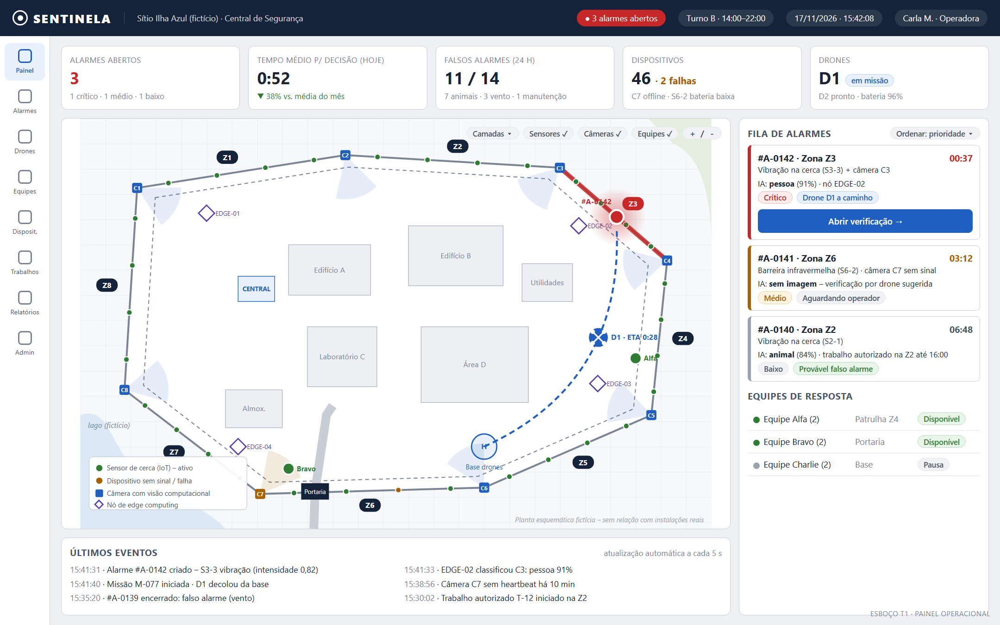
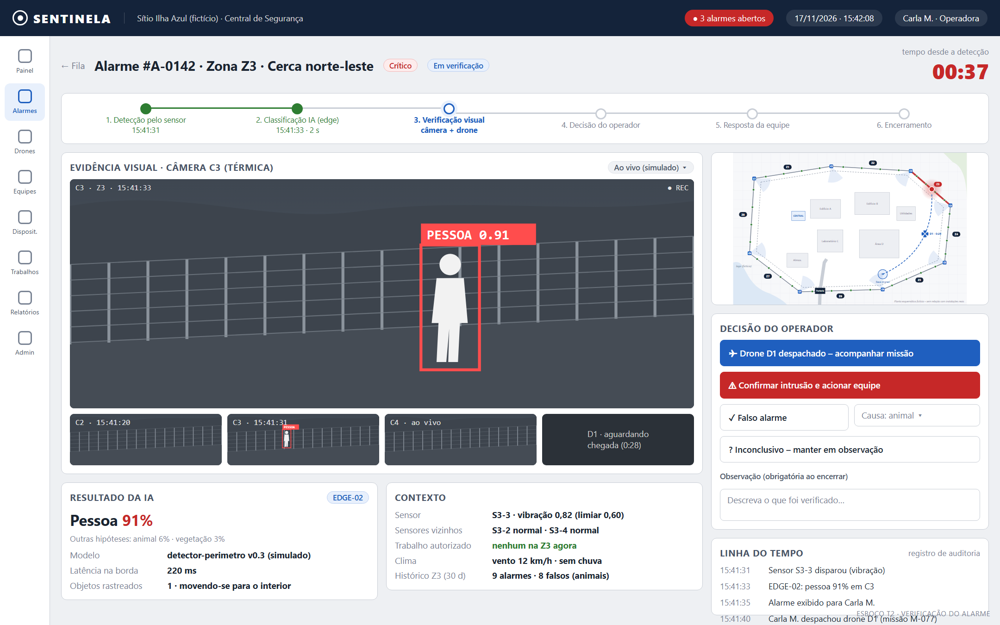
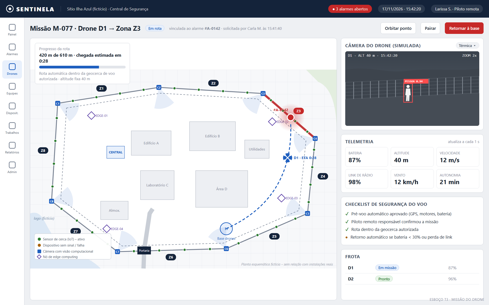
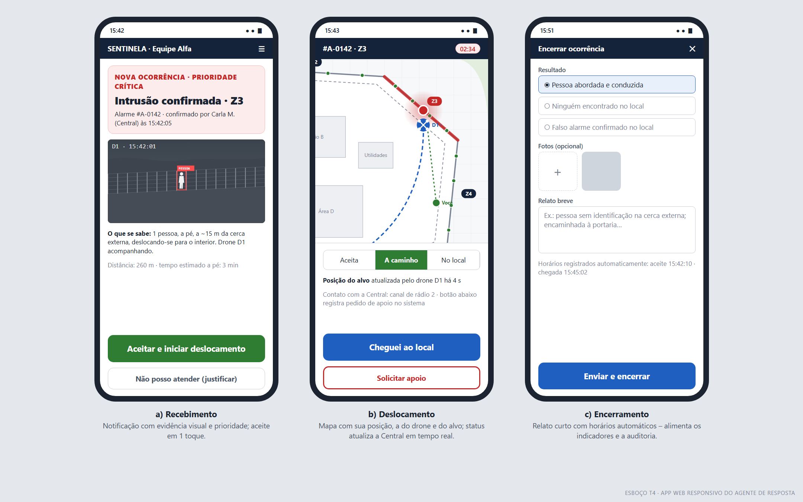
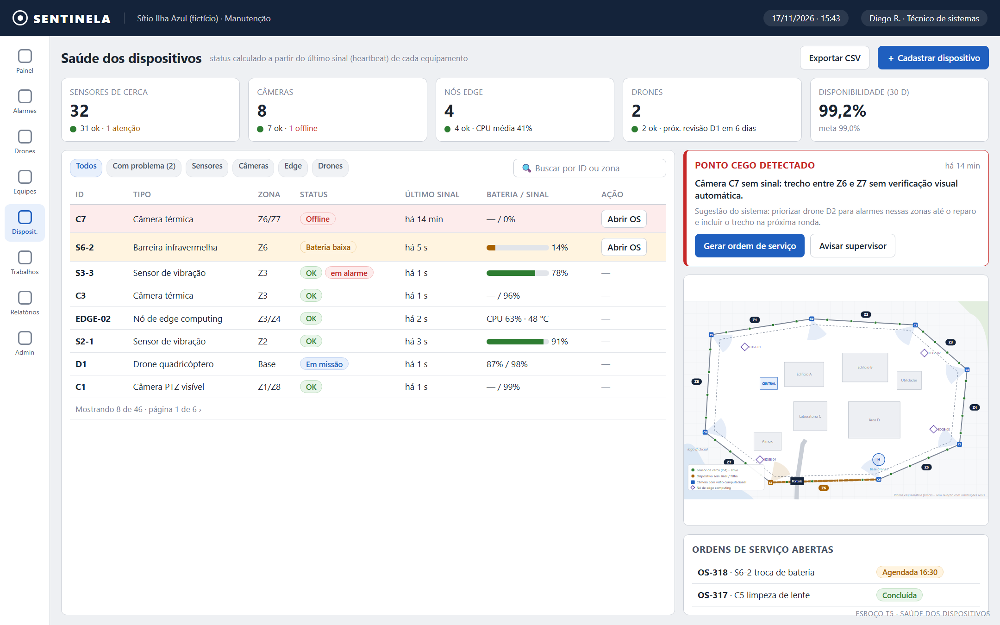
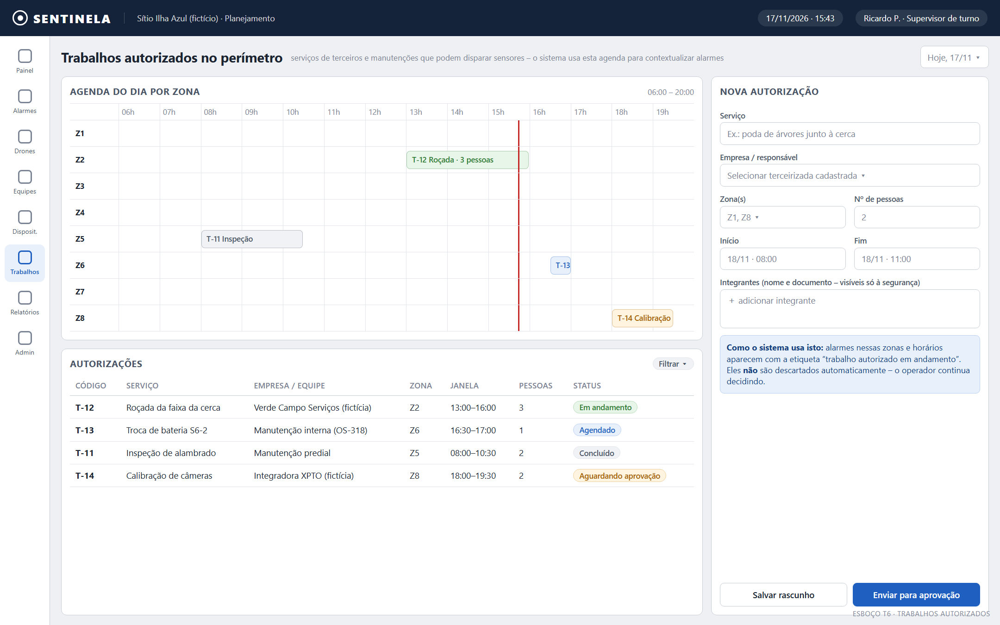
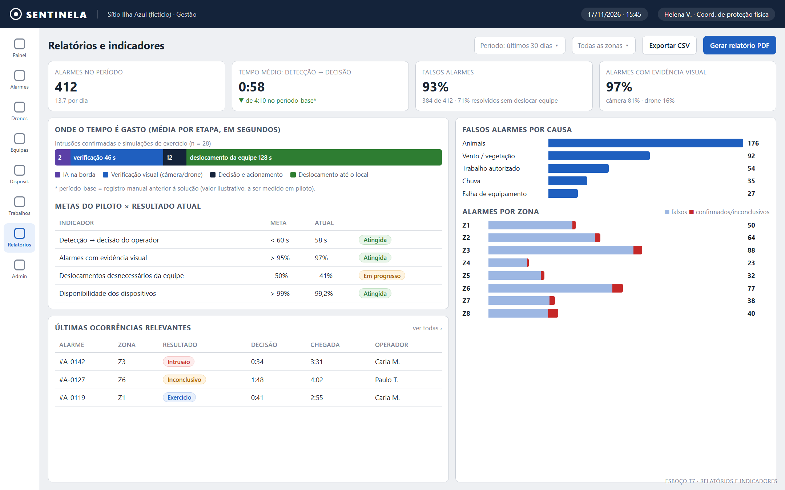
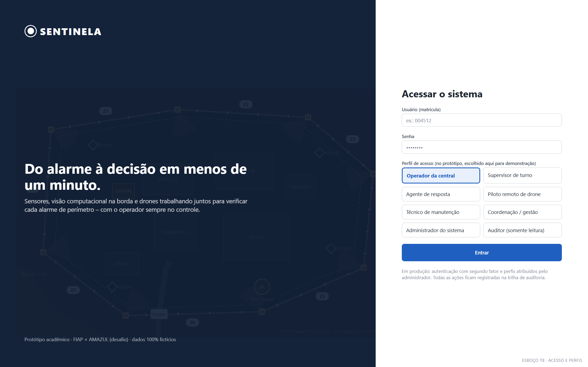

# SENTINELA — Verificação inteligente de alarmes de perímetro

> Do alarme à decisão em menos de um minuto.

Projeto acadêmico da disciplina **Application Development** (Ciências da Computação · FIAP · Prof. Rodrigo Settervall Moraes), desenvolvido para o desafio **FIAP × AMAZUL — Segurança Física em Instalações Nucleares**.

Este repositório reúne a entrega das **Sprints 1 e 2**: documento de planejamento, esboços das telas e vídeo pitch.



## Integrantes

| Nome | RM |
|---|---|
| Gustavo Franzoti Gonçalves | RM566983 |
| Maykon Santana Fonseca | RM567041 |

## O problema

Em instalações críticas, todo alarme de perímetro precisa ser **avaliado** antes de virar resposta. Hoje o operador procura a câmera certa, interpreta a imagem e, na dúvida, envia uma equipe só para "ir ver". A maior parte dos alarmes vem de animais, vento ou vegetação, e um alarme real pode se perder entre eles.

**Pergunta que guia o projeto:** *como reduzir o tempo entre o disparo de um alarme no perímetro e uma decisão confiável do operador, para que a equipe de resposta seja acionada mais cedo e só quando necessário?*

## A solução

O **SENTINELA** é uma plataforma web que integra:

- **Sensores IoT** de cerca (vibração, barreira infravermelha) que geram os alarmes;
- **Visão computacional na borda (edge computing)**, que classifica a imagem da câmera do trecho (pessoa, veículo, animal, vegetação);
- **Drones** para verificação aérea onde a câmera não cobre ou a classificação é inconclusiva;
- **Mapa operacional e dashboards** com zonas, dispositivos, equipes e indicadores.

O alarme chega ao operador já com evidência visual, classificação da IA e contexto (trabalhos autorizados, clima, histórico). **Quem decide é sempre uma pessoa.**

## Telas planejadas

| | |
|---|---|
|  **T1 · Painel operacional** |  **T2 · Verificação do alarme** |
|  **T3 · Missão do drone** |  **T4 · App do agente de resposta** |
|  **T5 · Saúde dos dispositivos** |  **T6 · Trabalhos autorizados** |
|  **T7 · Relatórios e indicadores** |  **T8 · Acesso e perfis** |

## Conteúdo do repositório

```
├── Planejamento_SENTINELA_Sprints1-2.pdf   # documento de entrega (PDF)
├── plano.md                                # documento de planejamento (fonte em Markdown)
├── integrantes.txt                         # integrantes e link do vídeo
├── telas/                                  # esboços das telas (PNG)
├── video/pitch_sentinela.mp4               # vídeo pitch (≈1min52s)
└── fonte/                                  # código que gera os entregáveis
    ├── build_pdf.py                        # plano.md -> documento.html -> PDF
    ├── render.py                           # renderiza HTML em PNG/PDF (Edge headless)
    ├── telas/                              # esboços das telas em HTML/CSS/JS
    └── video/                              # slides HTML e script de montagem do vídeo
```

## Como gerar os entregáveis

Requisitos: Windows, Python 3.10+, Microsoft Edge instalado.

```bash
pip install -r requirements.txt

python fonte/render.py telas          # gera telas/*.png a partir de fonte/telas/*.html
python fonte/build_pdf.py             # gera Planejamento_SENTINELA_Sprints1-2.pdf
python fonte/video/build_video.py     # gera video/pitch_sentinela.mp4 (narração com voz pt-BR do Windows)
```

## Vídeo pitch

- Arquivo: [`video/pitch_sentinela.mp4`](video/pitch_sentinela.mp4)
- YouTube (não listado): _adicionar link_

## Próximos passos (Sprints 3 e 4)

Construção da aplicação web com as 8 telas, usando dados simulados (JSON) de sensores, câmeras, IA e drones. Detalhes na seção 6 do [plano](plano.md).

## Aviso

Todas as informações sobre instalações, plantas, dispositivos, pessoas, empresas e números de operação são **fictícias** ou vêm de **fontes públicas** citadas no documento. O "Sítio Ilha Azul" é um local inventado. Este projeto não representa plantas reais, vulnerabilidades ou procedimentos operacionais de nenhuma instalação nuclear.
