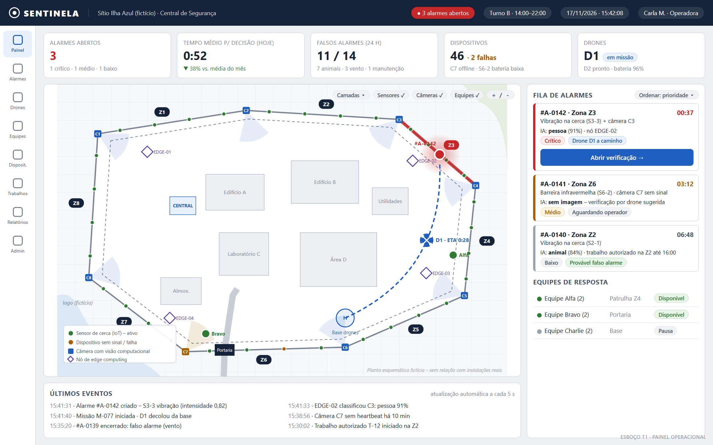
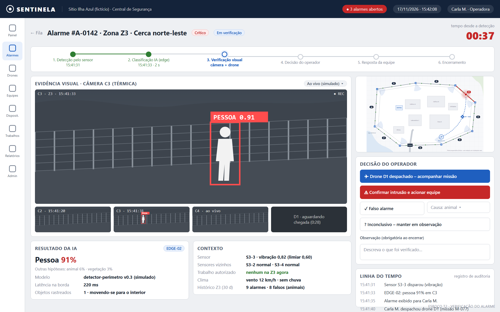
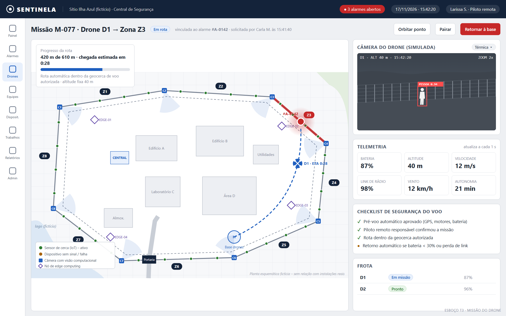
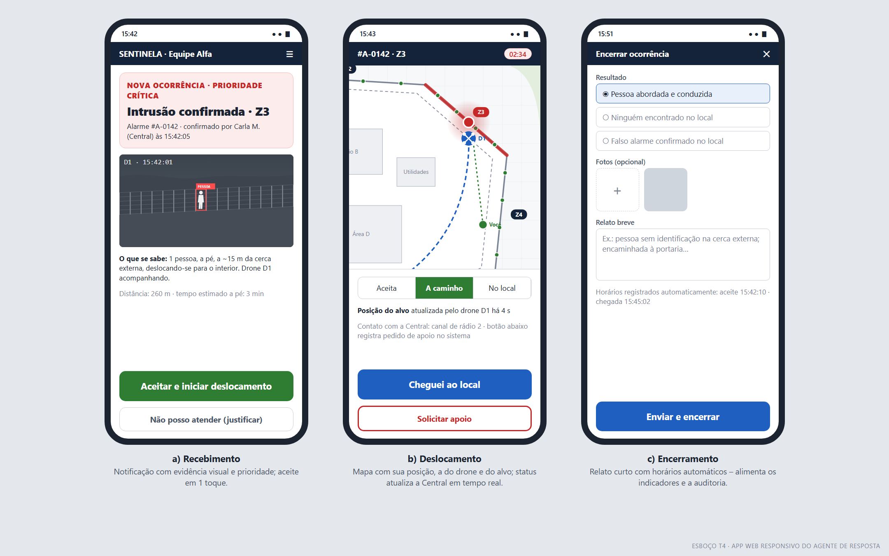
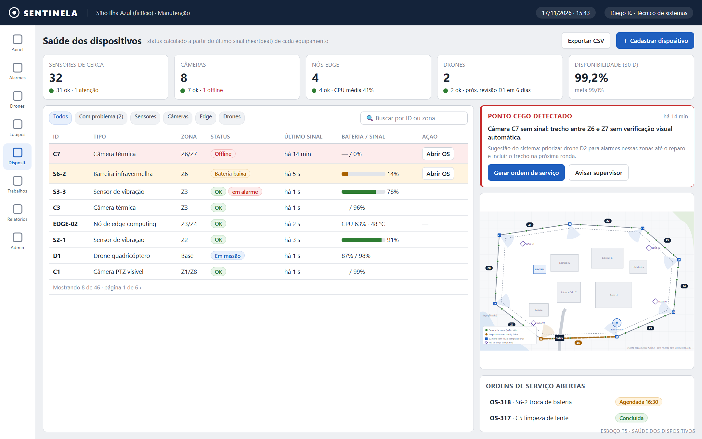
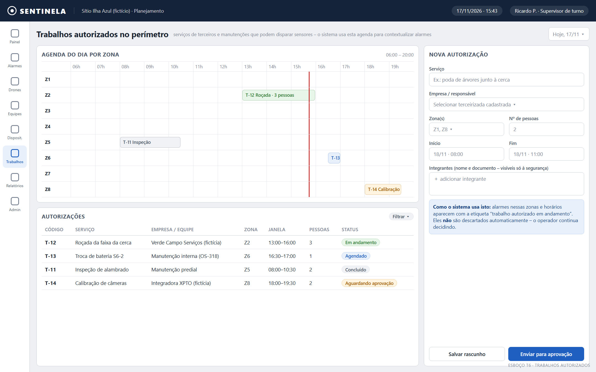
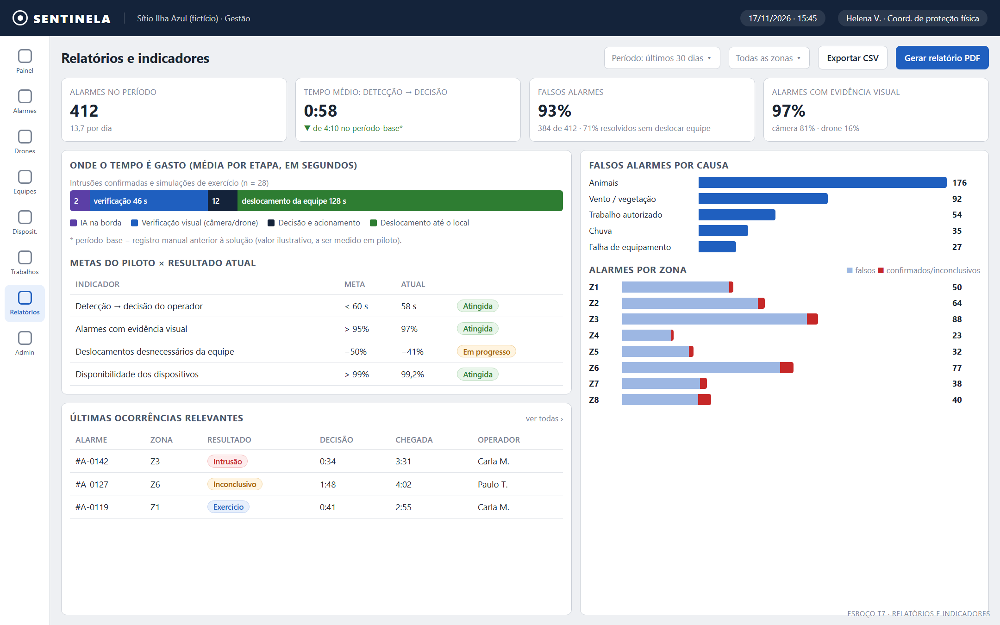
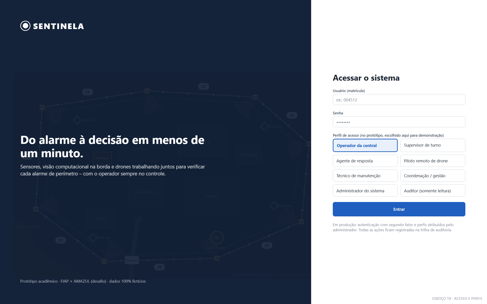

# SENTINELA — Verificação inteligente de alarmes de perímetro

**Documento de planejamento · Sprints 1 e 2 · Application Development**
Ciências da Computação · FIAP · Prof. Rodrigo Settervall Moraes
Desafio em parceria com a AMAZUL — *Segurança Física em Instalações Nucleares*

**Integrantes:** Gustavo Franzoti Gonçalves (RM566983) · Maykon Santana Fonseca (RM567041)

> **Aviso:** todas as informações sobre instalações, plantas, dispositivos, pessoas, empresas e números de operação neste documento são **fictícias** ou vêm de **fontes públicas** citadas. O "Sítio Ilha Azul" é um local inventado. Este documento não representa plantas reais, vulnerabilidades ou procedimentos operacionais de nenhuma instalação nuclear.

---

## Sumário executivo

| | |
|---|---|
| **Problema** | Em instalações críticas, cada alarme de perímetro precisa ser **avaliado** antes de virar resposta. Hoje essa avaliação depende de o operador encontrar a câmera certa, interpretar a imagem e, muitas vezes, enviar uma patrulha só para "ir ver". A maior parte dos alarmes é causada por animais, vento ou vegetação, o que consome tempo e atenção, e um alarme real pode se perder entre eles. |
| **Pergunta que guia o projeto** | *Como podemos reduzir o tempo entre o disparo de um alarme no perímetro e uma decisão confiável do operador (intrusão real ou falso alarme), para que a equipe de resposta seja acionada mais cedo e só quando necessário?* |
| **Solução** | **SENTINELA**: plataforma web que junta **sensores IoT** de cerca, **câmeras com visão computacional processada na borda (edge computing)**, **drones** que fazem a verificação aérea automática e um **mapa operacional geolocalizado**. Cada alarme já chega ao operador com **evidência visual, classificação da IA e contexto** (trabalhos autorizados, clima, histórico). O operador decide com um clique, e a equipe recebe a ocorrência no celular. |
| **Resultado para o usuário** | Decisão mais rápida e mais bem fundamentada, menos deslocamentos desnecessários da equipe, registro completo para auditoria e indicadores para a gestão. |
| **Escopo das Sprints 3 e 4** | Aplicação web com 8 telas principais (painel, verificação, missão do drone, app do agente, saúde dos dispositivos, trabalhos autorizados, relatórios e acesso). Sensores, câmeras, IA e drones serão **simulados** com dados fictícios em JSON. |

---

## 1. Solução proposta, contexto e recorte do problema

### 1.1 A solução escolhida: SENTINELA

**O que ela faz.** O SENTINELA é um sistema de **verificação de alarmes de perímetro**. Quando um sensor da cerca dispara, o sistema:

1. **Detecta**: o sensor IoT (vibração na cerca, barreira infravermelha) envia o evento com posição e intensidade.
2. **Classifica na borda**: um nó de *edge computing* próximo à cerca recebe a imagem da câmera daquele trecho e executa um modelo de **visão computacional**, que diz o que foi visto (pessoa, veículo, animal, vegetação ou nada) e com qual confiança, em poucos centésimos de segundo e sem depender do link com a central.
3. **Verifica com drone**: se não há câmera cobrindo o ponto, se a câmera está com falha ou se a classificação é inconclusiva, o operador despacha, com um clique, um **drone** que voa uma rota pré-aprovada até a coordenada do alarme e transmite imagem. Um **piloto remoto** habilitado supervisiona todos os voos, como exige a regulação.
4. **Apresenta tudo em um único lugar**: o alarme aparece no **mapa operacional** e na fila priorizada, com a evidência visual, o resultado da IA, os sensores vizinhos, o clima e a agenda de **trabalhos autorizados** naquela zona (por exemplo, uma equipe de roçada terceirizada).
5. **Apoia a decisão e a resposta**: o operador classifica o alarme (intrusão confirmada, falso alarme com causa, inconclusivo). Se confirmar, a equipe de resposta recebe a ocorrência no celular com foto, mapa e rota, e atualiza o status até o encerramento.
6. **Registra e mede**: cada etapa tem horário gravado automaticamente (trilha de auditoria). A gestão vê quanto tempo cada etapa leva, onde e por que surgem falsos alarmes e se algum dispositivo deixou de funcionar.

**Princípio de projeto: humano no controle.** A IA e o drone **não decidem sozinhos**. Eles reduzem o tempo para o operador ter a informação certa. Nenhum alarme é descartado automaticamente, nem mesmo durante um trabalho autorizado. O sistema só sinaliza o contexto.

**Tecnologias utilizadas (dentre os caminhos indicados no desafio):**

| Caminho tecnológico | Papel no SENTINELA |
|---|---|
| **IoT e sensores** | Sensores de vibração em cerca e barreiras infravermelhas geram os alarmes. Todos os dispositivos enviam *heartbeat* (sinal de vida) para o monitoramento de saúde. |
| **Visão computacional** | Detecção e classificação de objetos nas imagens das câmeras (pessoa / veículo / animal / vegetação) para avaliar o alarme em segundos. |
| **Edge computing** | Inferência executada em nós próximos às câmeras: menor latência, menos tráfego de vídeo pela rede e funcionamento mesmo com o link central degradado. |
| **Drones e sistemas autônomos** | Verificação aérea sob demanda em pontos sem cobertura de câmera ou com dúvida, com rota automática dentro de uma geocerca e piloto remoto responsável. |
| **Geolocalização, mapas e dashboards** | Mapa operacional com zonas, dispositivos, drones e equipes; fila de alarmes; indicadores e relatórios para gestão. |

**Resultado gerado para o usuário:**

- **Operador da central:** passa de "procurar a câmera e adivinhar" para "receber o alarme já com imagem, classificação e contexto".
- **Equipe de resposta:** sai menos vezes à toa e, quando sai, já sabe o que vai encontrar e onde.
- **Gestão:** tem números confiáveis (tempos por etapa, causas de falsos alarmes, disponibilidade dos equipamentos) para justificar investimentos e melhorias.
- **Manutenção:** fica sabendo na hora quando um sensor ou uma câmera para de funcionar, e o sistema mostra o ponto cego que isso cria.

### 1.2 Contexto: como funciona a atividade de proteção de perímetro em instalações críticas

*Esta seção descreve conceitos gerais e publicamente documentados. Não descreve procedimentos de nenhuma instalação específica.*

**Enquadramento regulatório.** No Brasil, a proteção física de materiais e instalações nucleares é regulada pela **Comissão Nacional de Energia Nuclear (CNEN)**. A norma **CNEN NN 2.01 – Proteção Física de Materiais e Instalações Nucleares** (aprovada pela Resolução CNEN nº 253/2019) estabelece princípios gerais e requisitos básicos para projetar, implantar e manter um **Sistema de Proteção Física** [1][2]. A atividade também se insere no **Sistema de Proteção ao Programa Nuclear Brasileiro (SIPRON)**, instituído pela Lei nº 12.731/2012 [3]. No plano internacional, a referência é a recomendação da Agência Internacional de Energia Atômica (AIEA), **Nuclear Security Series nº 13 (INFCIRC/225/Rev.5)** [4]. A **AMAZUL**, empresa pública vinculada ao Ministério da Defesa por meio do Comando da Marinha e criada a partir da Lei nº 12.706/2012, atua no desenvolvimento e na manutenção de tecnologias para o Programa Nuclear da Marinha, o PROSUB e o Programa Nuclear Brasileiro [5][6].

**O modelo "detectar, retardar, responder".** A literatura de proteção física descreve o sistema como um conjunto integrado de medidas para impedir que um ato malicioso seja concluído. Ele se organiza em três funções [4][7][8]:

- **Detecção:** perceber a ação do adversário (sensores, câmeras, vigilância). Inclui a **avaliação do alarme** (*alarm assessment*): saber se o alarme é real. A máxima repetida em treinamentos da área é que *"um alarme sem avaliação não é detecção"* [8].
- **Retardo:** barreiras físicas (cercas, portas, distância) que fazem o adversário gastar tempo.
- **Resposta:** a força de resposta interrompe a ação.

O critério central do projeto é que **o tempo somado de detecção, avaliação, comunicação e resposta precisa ser menor do que o tempo que o adversário leva para completar a ação** [7][8]. Por isso, recomenda-se que a detecção aconteça o mais longe possível do alvo, ou seja, **no perímetro**, onde cada segundo ganho na avaliação aumenta a margem da resposta (princípio da detecção oportuna) [7].

**Como a atividade funciona, em termos gerais.** Em instalações críticas, o perímetro costuma ter faixas de cerca monitoradas por sensores e câmeras, ligadas a uma **central de alarmes** onde operadores trabalham em turnos. Um ciclo típico, descrito de forma genérica na literatura [7], é:

1. Um sensor dispara e o alarme aparece na central.
2. O operador **avalia**: procura a câmera do trecho, observa a imagem e, se não tiver certeza, pede verificação presencial.
3. Se houver indício de intrusão, aciona a **força de resposta** por rádio ou telefone.
4. A equipe se desloca, verifica, age e informa a central.
5. O evento é **registrado** para controle e auditoria.

**Onde estão os gargalos (oportunidades):**

- **Alarmes improcedentes em grande quantidade.** Garcia (2008) distingue *alarmes falsos* (gerados pelo próprio equipamento) de *alarmes incômodos* (*nuisance alarms*: causados por animais, vento, vegetação, chuva). Ambos competem pela atenção do operador e, quando são muitos, reduzem a confiança no sistema [7]. *Neste documento, chamamos os dois de "falsos alarmes" para simplificar a linguagem das telas.*
- **Avaliação lenta e dependente de esforço manual:** achar a câmera certa, mover a câmera, comparar com a agenda de serviços, tudo sob pressão de tempo.
- **Pontos cegos:** trechos sem câmera ou com câmera em falha obrigam a enviar uma patrulha só para "ver".
- **Falhas silenciosas:** um sensor ou uma câmera parada sem que ninguém perceba deixa um trecho desprotegido.
- **Registros incompletos:** sem horários automáticos, é difícil medir onde o tempo é gasto e melhorar.

**Por que drones, visão computacional e edge agora.** O uso de drones em segurança patrimonial no Brasil é regulado pela **ANAC** (RBAC-E nº 94, requisitos para aeronaves não tripuladas de uso civil) e pelo **DECEA** (ICA 100-40, acesso ao espaço aéreo por aeronaves não tripuladas, versão aprovada em março de 2026) [9][10]. Essas regras exigem piloto remoto responsável e autorização de acesso ao espaço aéreo, o que reforça o desenho "drone automatizado com piloto supervisor" adotado aqui. A visão computacional embarcada em equipamentos de borda permite classificar imagens perto da fonte, sem enviar vídeo bruto continuamente à central. Por envolver imagens de pessoas (empregados, terceirizados, visitantes, vizinhos), a solução também precisa respeitar a **Lei Geral de Proteção de Dados (Lei nº 13.709/2018)** [11].

### 1.3 Recorte do problema

> ### Como podemos reduzir o tempo entre o disparo de um alarme no perímetro e uma decisão confiável do operador (intrusão real ou falso alarme), para que a equipe de resposta seja acionada mais cedo e só quando necessário?

**Por que este recorte.** Pelo modelo detectar-retardar-responder, a **avaliação** é a etapa que liga a detecção à resposta e a que mais depende de esforço humano. Melhorá-la tem efeito duplo: **ganha tempo** nos alarmes reais e **evita deslocamentos** nos falsos.

**Dentro do recorte:**

- alarmes gerados por sensores de **perímetro** (faixa de cerca externa) e sua verificação visual (câmera + drone);
- decisão do operador, acionamento da equipe e encerramento da ocorrência;
- monitoramento da **saúde dos dispositivos** que sustentam essa verificação, porque um sensor ou câmera parada compromete o fluxo;
- **agenda de trabalhos autorizados** no perímetro, como contexto para reduzir alarmes incômodos causados por terceirizados;
- indicadores e trilha de auditoria.

**Fora do recorte (nesta proposta):** controle de acesso de pessoas e veículos em portarias e catracas, rondas internas, proteção de áreas internas e alvos, segurança cibernética da instalação e qualquer aspecto de operação nuclear. Também ficam de fora decisões automáticas de resposta (a IA nunca aciona a equipe sozinha) e qualquer ação ofensiva com drones.

**Indicadores de sucesso (metas-hipótese, a validar em piloto):**

| Indicador | Como medir | Meta-hipótese |
|---|---|---|
| Tempo detecção → decisão do operador | diferença entre o horário do alarme e o horário da classificação pelo operador | **< 60 s** na mediana |
| Alarmes com evidência visual no momento da decisão | % de alarmes com imagem de câmera ou drone anexada | **> 95%** |
| Deslocamentos desnecessários da equipe | equipes acionadas para alarmes que se revelaram falsos | **−50%** em relação ao período-base |
| Tempo para detectar dispositivo com falha | tempo entre o último *heartbeat* e o alerta | **< 2 min** |

*As metas são hipóteses de projeto. Os números que aparecem nas telas são fictícios.*

**Por que esta é a solução mais adequada (comparação com alternativas):**

| Alternativa | Vantagem | Limitação frente ao recorte |
|---|---|---|
| Mais vigilantes e patrulhas | Verificação presencial confiável | Custo alto e contínuo; o deslocamento continua sendo a etapa mais lenta; não reduz falsos alarmes |
| Mais câmeras, sem IA | Amplia a cobertura visual | Mais telas para o operador olhar; a avaliação continua manual; pontos cegos e falhas ainda exigem patrulha |
| Analítica de vídeo centralizada (nuvem/servidor) | Classificação automática | Depende do link e do envio contínuo de vídeo; latência maior; ponto único de falha |
| Só drones em ronda programada | Cobertura aérea flexível | Não responde ao alarme no momento em que ele acontece; autonomia e regulação limitam voos contínuos |
| **SENTINELA (sensores + CV na borda + drone sob demanda + mapa)** | **Cada alarme chega já avaliado e com contexto; o drone cobre pontos cegos só quando necessário; a saúde dos dispositivos é monitorada; o humano decide** | Exige integração entre vários sistemas e um modelo de IA bem calibrado. O protótipo deste projeto simula essas integrações. |

---

## 2. Personas envolvidas

*Personas fictícias, construídas a partir dos papéis descritos na literatura de proteção física e na regulação citada.*

### 2.1 Tabela de personas

| # | Persona (fictícia) | Grupo | Papel | Objetivo | Como interage com a solução | Principal dor |
|---|---|---|---|---|---|---|
| P1 | **Carla Menezes**, 34, operadora da central de segurança | Usa diretamente | Monitora alarmes e decide o que fazer com cada um | Avaliar cada alarme rápido e sem errar | Painel (T1), verificação (T2), despacho de drone, acionamento de equipe | Muitos alarmes improcedentes; precisa caçar a câmera certa sob pressão; medo de deixar passar um alarme real |
| P2 | **Ricardo Prado**, 45, supervisor de turno | Usa diretamente | Coordena operadores e equipes no turno; aprova trabalhos no perímetro | Turno sem surpresas, com recursos bem distribuídos | Painel, trabalhos autorizados (T6), escalonamentos, passagem de turno | Pouca visibilidade do que está acontecendo em tempo real; agendas de terceiros em planilhas e papel |
| P3 | **Júlio Santos**, 29, agente da equipe de resposta | Usa diretamente (celular) | Vai ao local verificar e agir | Chegar rápido, com segurança e sabendo o que vai encontrar | App do agente (T4): recebe, aceita, navega, informa status e encerra | É chamado "para ver" sem informação; descrição imprecisa do local; relatório manual no fim do turno |
| P4 | **Larissa Souza**, 31, piloto remota de drone | Usa diretamente | Responsável legal e técnica por cada voo | Voos seguros, dentro das regras e rápidos | Missão do drone (T3): confirma voo, acompanha telemetria, comanda retorno | Pedidos de voo sem contexto; preparar um voo manualmente leva tempo; responsabilidade regulatória |
| P5 | **Helena Vieira**, 50, coordenadora de proteção física | Recebe informações | Responde pelo sistema de proteção física perante a direção e o regulador | Comprovar desempenho e priorizar investimentos | Relatórios e indicadores (T7), auditoria | Dados dispersos e manuais; difícil provar que o sistema funciona e onde investir |
| P6 | **Diretor(a) da instalação** | Recebe informações | Alta gestão | Garantir segurança com custo controlado | Relatório mensal em PDF gerado pelo sistema | Recebe informação tarde e pouco objetiva |
| P7 | **Inspetor(a) do órgão regulador** (fictício) | Recebe informações | Fiscaliza o cumprimento dos requisitos de proteção física | Verificar evidências de que o sistema é operado e mantido | Acesso de auditor somente leitura; relatórios e trilha de auditoria exportados | Evidências incompletas ou montadas às pressas antes da inspeção |
| P8 | **Comandante de força de apoio externa** | Recebe informações | Força acionada em caso de evento que exceda a capacidade local | Receber informação clara para apoiar | Recebe resumo da ocorrência (exportado) via central | Informação fragmentada passada por telefone |
| P9 | **Marcos Lima**, 38, empregado da instalação | Afetado | Trabalha em prédios próximos ao perímetro | Trabalhar sem ser incomodado e ter a privacidade respeitada | Indireto: aparece em imagens; pode gerar alarmes | Desconforto com câmeras e drones; falta de transparência sobre uso das imagens |
| P10 | **Antônio Ribeiro**, 52, terceirizado de roçada (empresa fictícia) | Afetado | Faz manutenção de vegetação junto à cerca | Trabalhar sem ser abordado por engano | Indireto: sua equipe é cadastrada em um trabalho autorizado (T6) | É confundido com intruso; serviço interrompido; burocracia para autorização |
| P11 | **Visitante técnico** (ex.: pesquisador em visita) | Afetado | Circula acompanhado em áreas permitidas | Visita tranquila | Indireto: pode aparecer em imagens | Não sabe que regras de imagem se aplicam |
| P12 | **Comunidade vizinha** | Afetado | Moradores e pescadores próximos ao sítio | Não ter a privacidade invadida | Indireto: drones voam apenas dentro da geocerca do sítio | Preocupação com drones filmando fora da área |
| P13 | **Diego Rocha**, 36, técnico de sistemas eletrônicos de segurança | Mantém | Instala e repara sensores, câmeras e nós de borda | Corrigir falhas antes que virem pontos cegos | Saúde dos dispositivos (T5), ordens de serviço | Descobre falhas só quando alguém reclama; não sabe qual equipamento priorizar |
| P14 | **Técnico(a) de manutenção de drones** | Mantém | Baterias, revisões, registros de voo | Frota sempre pronta | Status da frota, horas de voo, alertas de revisão | Controle de manutenção em planilha |
| P15 | **Administrador(a) de TI / sistema** | Mantém | Usuários, perfis, servidores, rede, backups | Sistema disponível e seguro | Administração (usuários, perfis, cadastro de zonas e dispositivos) | Muitos sistemas isolados; controle de acesso difícil |
| P16 | **Cientista de dados / engenheiro(a) de ML** | Mantém | Treina e monitora o modelo de visão computacional | Modelo com alta taxa de acerto e poucos alarmes errados | Usa as classificações confirmadas pelos operadores como dados de reavaliação | Falta de dados rotulados; não sabe quando o modelo erra |
| P17 | **Encarregado(a) de dados (DPO)** | Mantém (governança) | Garante conformidade com a LGPD | Uso de imagens proporcional e transparente | Define retenção de imagens, perfis de acesso e avisos | Imagens guardadas sem política; acesso amplo demais |

### 2.2 Jornadas resumidas

| Persona | O que faz hoje | Em que momento usa o SENTINELA | O que muda |
|---|---|---|---|
| **P1 Carla (operadora)** | Recebe o alarme, procura a câmera, aproxima a imagem, liga para a patrulha "ir ver", anota no livro | Durante todo o turno: o alarme abre na fila (T1) e ela entra na verificação (T2) | Recebe o alarme **já com imagem, classificação e contexto**; despacha drone com 1 clique; decide em segundos; o registro é automático |
| **P2 Ricardo (supervisor)** | Circula entre telas, recebe ligações, aprova serviços por e-mail ou papel | No início do turno (agenda T6), durante eventos críticos (T1) e na passagem de turno | Visão única do turno; trabalhos autorizados aparecem no contexto do alarme; passagem de turno com histórico |
| **P3 Júlio (agente)** | Recebe chamada de rádio com descrição vaga e vai ao local sem imagem | Quando a central confirma uma intrusão ou pede verificação (T4) | Chega sabendo **onde e o quê** (foto e posição atualizada pelo drone); informa status com toques; relatório curto com horários automáticos |
| **P4 Larissa (piloto)** | Planeja voos manualmente e recebe pedidos por rádio | Quando o operador solicita uma missão (T3) | Missão pré-planejada dentro da geocerca; ela só confirma e supervisiona; telemetria e retorno automático na tela |
| **P5 Helena (coordenação)** | Consolida planilhas mensais à mão | Semanal e mensalmente, e antes de inspeções (T7) | Indicadores prontos (tempos por etapa, causas, disponibilidade); relatório PDF em 1 clique |
| **P6 Direção** | Recebe resumos tardios | Reunião mensal | Relatório objetivo com tendência e metas |
| **P7 Inspetor(a)** | Analisa registros em papel e entrevistas | Durante inspeções | Acesso somente leitura à trilha de auditoria e a relatórios exportados |
| **P8 Força externa** | Recebe informação por telefone | Só em eventos escalados | Recebe resumo padronizado da ocorrência (local, horário, imagens) |
| **P9 Marcos (empregado)** | Desconhece regras de uso de imagens | Sempre que circula perto do perímetro (indireto) | Política de privacidade clara; imagens com retenção limitada e acesso por perfil |
| **P10 Antônio (terceirizado)** | É abordado por engano quando a cerca dispara durante a roçada | Ao executar serviço autorizado (indireto, via T6) | O alarme na sua zona aparece marcado como "trabalho autorizado em andamento"; menos abordagens indevidas |
| **P11 Visitante** | Recebe orientações verbais | Durante a visita (indireto) | Aviso formal sobre monitoramento; nada muda na rotina da visita |
| **P12 Comunidade** | Vê drones e não sabe por quê | Indireto | Voos restritos à geocerca do sítio; câmera do drone voltada para dentro da área |
| **P13 Diego (técnico)** | Descobre falhas por reclamação ou na ronda | Diariamente e ao receber alerta de dispositivo offline (T5) | Alerta em minutos, com o **ponto cego** destacado no mapa; ordem de serviço gerada pela tela |
| **P14 Téc. drones** | Controla baterias e revisões em planilha | Antes e depois dos voos | Horas de voo e alertas de revisão registrados automaticamente |
| **P15 Admin TI** | Gerencia usuários em vários sistemas | Na entrada e saída de pessoas e na manutenção | Cadastro único de usuários, perfis e dispositivos; trilha de auditoria |
| **P16 Cientista de dados** | Não recebe retorno sobre os erros do modelo | Periodicamente, na revisão do modelo | As decisões dos operadores viram rótulos para medir e melhorar o modelo |
| **P17 DPO** | Política de imagens genérica | Na definição de regras e em auditorias | Retenção e perfis de acesso configurados; registro de quem viu quais imagens |

---

## 3. Escopo da solução

### 3.1 O que a aplicação vai fazer (Sprints 3 e 4)

Prioridade: **M** = obrigatório (*must*), **S** = desejável (*should*), **C** = se houver tempo (*could*).

| ID | Funcionalidade | Tela | Prior. |
|---|---|---|---|
| F01 | Entrar no sistema escolhendo um perfil (operador, supervisor, agente, piloto, técnico, gestão, administrador, auditor) e ver apenas o menu daquele perfil | T8 | M |
| F02 | Exibir no **mapa** do sítio fictício as zonas, sensores, câmeras, nós de borda, base de drones e equipes, com o **status** de cada um por cor | T1 | M |
| F03 | Exibir a **fila de alarmes** ordenada por prioridade, com cronômetro desde a detecção e resumo da classificação da IA | T1 | M |
| F04 | Abrir a **verificação de um alarme**: imagem da câmera com a caixa de detecção, classificação e confiança, sensores vizinhos, clima, trabalhos autorizados e histórico da zona | T2 | M |
| F05 | Mostrar a **linha do tempo** do alarme (etapas: detecção, IA, verificação, decisão, resposta, encerramento) com horários | T2 | M |
| F06 | **Classificar o alarme** como intrusão confirmada, falso alarme (com causa obrigatória) ou inconclusivo, com observação | T2 | M |
| F07 | **Despachar o drone** até o ponto do alarme e acompanhar a missão: rota animada no mapa, telemetria, imagem e comandos (pairar, orbitar, retornar) | T3 | M |
| F08 | **Acionar a equipe de resposta** e acompanhar o status (enviada, aceita, a caminho, no local, encerrada) | T1/T4 | M |
| F09 | **Tela responsiva do agente**: receber a ocorrência, aceitar, ver o mapa, atualizar status, solicitar apoio e encerrar com relato | T4 | M |
| F10 | Listar a **saúde dos dispositivos** com último sinal, bateria/sinal e filtros; destacar no mapa os pontos cegos | T5 | M |
| F11 | Gerar e acompanhar **ordens de serviço** para dispositivos com problema | T5 | S |
| F12 | Cadastrar e aprovar **trabalhos autorizados** por zona e horário; marcar os alarmes que ocorrem nessas janelas | T6 | S |
| F13 | Exibir **indicadores**: tempo médio por etapa, falsos alarmes por causa e por zona, metas × resultado | T7 | M |
| F14 | **Exportar** relatórios em CSV (e PDF, se houver tempo) | T7 | S/C |
| F15 | Registrar a **trilha de auditoria** (quem fez o quê e quando) e exibi-la ao auditor | T2/T7 | S |
| F16 | Cadastro de zonas, dispositivos e usuários (administração) | Admin | C |
| F17 | Notificação sonora e visual de novo alarme crítico | T1 | S |

### 3.2 O que será simulado

| ID | Na solução real viria de… | No protótipo será… |
|---|---|---|
| S01 | Sensores IoT de cerca (vibração, infravermelho) | Arquivo **`eventos-sensores.json`** com eventos inventados (id, sensor, zona, tipo, intensidade, horário) e um **gerador** que "dispara" um evento a cada N segundos para demonstração |
| S02 | *Heartbeat* dos dispositivos | **`dispositivos.json`** com status, bateria e último sinal; um temporizador altera aleatoriamente alguns valores e força a câmera C7 a ficar offline no roteiro de demonstração |
| S03 | Imagens das câmeras | **Imagens ilustrativas** (desenhos/fotos livres de direitos, sem nenhuma instalação real) por câmera e por cenário (pessoa, animal, vazio) |
| S04 | Inferência de visão computacional | Resultado **pré-calculado no JSON** (classe, confiança, caixa delimitadora em coordenadas). Nenhum modelo real roda no protótipo |
| S05 | Edge computing (nós de borda) | Um **serviço simulado** que devolve a classificação com uma latência artificial (ex.: 200 ms) e nós `EDGE-0x` cadastrados com CPU e temperatura fictícias |
| S06 | Drone (voo, GPS, telemetria e vídeo) | **Rota interpolada** entre a base e o ponto do alarme, com bateria, altitude e velocidade calculadas por fórmula; "vídeo" = imagem estática ou GIF ilustrativo |
| S07 | Mapa georreferenciado da instalação | **Planta esquemática fictícia** (imagem/SVG) com coordenadas próprias (sistema de coordenadas simples, sem latitude/longitude reais) |
| S08 | Posição GPS das equipes | Coordenadas fictícias atualizadas por temporizador ao longo de uma rota |
| S09 | Autenticação corporativa e perfis | **Usuários fictícios** em JSON; login simplificado com escolha de perfil; sem senha real |
| S10 | Notificações *push* no celular do agente | Notificação **dentro da própria aplicação** (página do agente aberta em outra aba ou no celular) |
| S11 | Rádio e integração com forças externas | Botões que **apenas registram** o pedido na linha do tempo |
| S12 | Estação meteorológica | **`clima.json`** com vento e chuva fictícios |
| S13 | Histórico de 30 dias para indicadores | **Base fictícia** com ~400 alarmes gerados por script, com distribuição plausível de causas |

**Exemplo de evento simulado (S01 + S04):**

```json
{
  "id": "A-0142",
  "sensor": "S3-3",
  "tipo": "vibracao_cerca",
  "zona": "Z3",
  "posicao": { "x": 850, "y": 156 },
  "intensidade": 0.82,
  "detectadoEm": "2026-11-17T15:41:31-03:00",
  "camera": "C3",
  "ia": { "no": "EDGE-02", "classe": "pessoa", "confianca": 0.91,
          "caixa": [360, 130, 60, 128], "latenciaMs": 220 },
  "prioridade": "critica"
}
```

### 3.3 Proposta técnica para as Sprints 3 e 4 (preliminar)

- **Front-end:** aplicação web responsiva (ex.: React + Vite), mapa com **Leaflet** em modo de coordenadas simples sobre a planta fictícia, gráficos com uma biblioteca leve (ex.: Recharts ou Chart.js).
- **Dados:** arquivos JSON servidos por um *mock* de API (ex.: `json-server`) para permitir criação e atualização de registros (classificação, ordens de serviço, trabalhos autorizados).
- **Simulação:** módulo `simulador` com temporizadores que geram eventos, atualizam *heartbeats* e movem o drone e as equipes.
- **Fora do escopo do protótipo:** integração com equipamentos reais, modelo de IA real, vídeo ao vivo e autenticação real.

---

## 4. Telas principais

Os esboços abaixo são de **baixa/média fidelidade**: mostram o que aparece em cada tela e como a informação está organizada, não o visual final. Todos os dados são fictícios.

### T1 · Painel operacional



**Para quem:** operador e supervisor. **Objetivo:** consciência situacional em uma única tela. No topo, **indicadores do turno** (alarmes abertos, tempo médio até a decisão, falsos alarmes, dispositivos com falha, drones). No centro, o **mapa** do sítio fictício com as zonas Z1–Z8, sensores (pontos verdes; laranja = falha), câmeras com campo de visão, nós de borda, base de drones, posição das equipes e a **rota do drone** em missão. O alarme ativo pulsa em vermelho e destaca o trecho da cerca. À direita, a **fila de alarmes** priorizada com cronômetro, resumo da IA e o contexto (por exemplo, "trabalho autorizado na Z2"), mais o status das equipes. Embaixo, o feed de eventos recentes.

### T2 · Verificação do alarme



**Para quem:** operador. **Objetivo:** decidir rápido e bem. A barra de **etapas** mostra em que ponto do ciclo o alarme está e quanto tempo passou (cronômetro grande). À esquerda, a **evidência visual** da câmera com a caixa de detecção da IA e miniaturas das câmeras vizinhas e do drone. Abaixo, o **resultado da IA** (classe, confiança, hipóteses alternativas, nó de borda e latência) e o **contexto** (sensor e intensidade, sensores vizinhos, trabalho autorizado, clima, histórico da zona). À direita, minimapa, **painel de decisão** (despachar drone, confirmar intrusão, falso alarme com causa obrigatória, inconclusivo) e a **linha do tempo**, que também é a trilha de auditoria.

### T3 · Missão do drone



**Para quem:** piloto remoto (e operador, em modo leitura). **Objetivo:** verificação aérea segura. O mapa mostra a **rota automática** da base até o alarme e o progresso. À direita, a **imagem da câmera do drone** com a detecção, a **telemetria** (bateria, altitude, velocidade, link, vento, autonomia), o **checklist de segurança** (pré-voo, confirmação do piloto, geocerca, retorno automático) e o status da frota. Os comandos ficam no topo (orbitar, pairar, retornar à base).

### T4 · App do agente de resposta (web responsivo)



**Para quem:** agente da equipe de resposta, no celular. **Objetivo:** chegar rápido sabendo o que vai encontrar. **(a)** Recebimento da ocorrência com prioridade, imagem e o que já se sabe, com aceite em um toque. **(b)** Deslocamento: mapa com a posição do agente, do drone e do alvo, e um seletor de status (aceita, a caminho, no local) que atualiza a central em tempo real, além do botão "solicitar apoio". **(c)** Encerramento: resultado, fotos opcionais e relato curto. Os horários são registrados automaticamente.

### T5 · Saúde dos dispositivos



**Para quem:** técnico de manutenção e supervisor. **Objetivo:** perceber falhas antes que virem pontos cegos. Os indicadores por tipo de dispositivo ficam no topo. A tabela filtrável mostra ID, tipo, zona, status, último sinal e bateria/sinal, com ação "Abrir OS". O cartão **"Ponto cego detectado"** explica o impacto da falha (ex.: câmera C7 offline deixa o trecho Z6/Z7 sem verificação visual) e sugere uma ação (priorizar drone). O mapa destaca o trecho afetado. Embaixo, as ordens de serviço abertas.

### T6 · Trabalhos autorizados no perímetro



**Para quem:** supervisor (cadastra e aprova) e operador (consulta). **Objetivo:** reduzir alarmes incômodos e abordagens indevidas a terceirizados. A **agenda do dia por zona** (linha vermelha = agora), a lista de autorizações com empresa (fictícia), janela, número de pessoas e status, e o formulário de **nova autorização**. Um aviso deixa claro que o sistema **não descarta** alarmes automaticamente: só os etiqueta.

### T7 · Relatórios e indicadores



**Para quem:** coordenação de proteção física, direção e auditor. **Objetivo:** medir e melhorar. Indicadores do período (volume, tempo até decisão, % de falsos alarmes, % com evidência visual). Gráfico **"onde o tempo é gasto"**, com as etapas IA, verificação, decisão e deslocamento. **Falsos alarmes por causa** e **por zona**, tabela **metas × resultado** e últimas ocorrências relevantes. Exportação em CSV e PDF.

### T8 · Acesso e perfis



**Para quem:** todos os usuários. **Objetivo:** entrar com o perfil certo. No protótipo, o perfil é escolhido na tela para facilitar a demonstração. O texto explica que, em produção, haveria segundo fator de autenticação e perfis atribuídos pelo administrador. Cada perfil vê apenas as telas pertinentes:

| Perfil | Telas |
|---|---|
| Operador | T1, T2, T3 (leitura), T5 (leitura), T6 (leitura) |
| Supervisor | T1–T3, T5, T6 (aprova), T7 |
| Agente de resposta | T4 |
| Piloto remoto | T3, T1 (leitura) |
| Técnico | T5 |
| Coordenação / gestão | T7, T1 (leitura) |
| Administrador | Admin, T5 |
| Auditor | T7 e trilha de auditoria (somente leitura) |

### Fluxo entre as telas

```
T8 Acesso ──► T1 Painel ──(novo alarme)──► T2 Verificação ──(sem imagem/dúvida)──► T3 Missão do drone
                 ▲                              │                                         │
                 │                              ├──(falso alarme: registra causa)─────────┘
                 │                              └──(intrusão)──► T4 App do agente ──► encerramento
                 │                                                                         │
   T5 Saúde dos dispositivos ◄──(dispositivo offline)          T7 Relatórios ◄────────────┘
   T6 Trabalhos autorizados ──(contexto)──► T2
```

---

## 5. Vídeo pitch

**Link do YouTube (não listado):** `COLE_AQUI_O_LINK_DO_VIDEO` *(verificar se abre em janela anônima antes de entregar)*

Um vídeo de apoio gerado a partir deste documento acompanha a entrega (`video/pitch_sentinela.mp4`, 1min52s, 1920×1080, com narração sintetizada em português). O grupo pode publicá-lo como está ou regravá-lo com a própria voz seguindo o roteiro abaixo.

**Roteiro (≈ 1min52s, mesmo texto da narração do vídeo de apoio):**

| Tempo | Cena (o que aparece) | Fala |
|---|---|---|
| 0:00–0:11 | Título SENTINELA | "Em uma instalação nuclear, todo alarme de perímetro precisa de uma resposta rápida: é real ou não é? Nós somos o grupo SENTINELA." |
| 0:11–0:34 | Problema e pergunta "Como podemos..." | "Hoje, o operador procura a câmera certa, interpreta a imagem e, na dúvida, manda uma equipe só para ver. A maioria dos alarmes vem de animais, vento ou vegetação. Nossa pergunta: como reduzir o tempo entre o disparo do alarme e uma decisão confiável, acionando a equipe mais cedo, e só quando for preciso?" |
| 0:34–0:54 | Fluxo da solução (sensor → IA na borda → drone → operador → equipe) | "O SENTINELA une sensores IoT na cerca, câmeras com visão computacional processada na borda, drones que fazem a verificação aérea automática e um mapa operacional. O alarme já chega ao operador com imagem, classificação da IA e contexto. E quem decide é sempre uma pessoa." |
| 0:54–1:12 | Personas (4 grupos) | "Mapeamos dezessete personas: quem usa, como a operadora, o agente de resposta e a piloto de drone; quem recebe informação, como a coordenação e o regulador; quem é afetado, como terceirizados e vizinhos; e quem mantém, como técnicos e o encarregado de dados." |
| 1:12–1:24 | Telas T1 e T2 | "No painel, o alarme aparece no mapa e na fila, com cronômetro. Na verificação, a operadora vê a evidência e o contexto, e decide com um clique." |
| 1:24–1:37 | Telas T3, T4 e T5 | "O drone vai até o ponto que a câmera não cobre. O agente recebe a ocorrência no celular. E a manutenção vê na hora quando um dispositivo para, e qual ponto cego isso cria." |
| 1:37–1:52 | Próximos passos | "Nas sprints três e quatro, vamos construir a aplicação web, com dados simulados de sensores, IA e drones. A meta: decisão em menos de um minuto. SENTINELA: do alarme à decisão." |

---

## 6. Próximos passos (Sprints 3 e 4)

| Sprint | Entregas planejadas |
|---|---|
| **3** | Estrutura do projeto e navegação por perfil (F01); mapa com dispositivos e status (F02); fila de alarmes e simulador de eventos (F03, S01–S05); tela de verificação com classificação (F04–F06); base de dados fictícia em JSON |
| **4** | Missão do drone (F07, S06); acionamento e app do agente (F08–F09); saúde dos dispositivos e OS (F10–F11); trabalhos autorizados (F12); relatórios e exportação (F13–F14); trilha de auditoria (F15); testes com roteiro de demonstração |

**Riscos e cuidados:** escopo grande para duas sprints (mitigação: priorização M/S/C), complexidade do mapa (mitigação: planta em SVG com coordenadas simples) e o risco de parecer que a IA decide sozinha (mitigação: o painel de decisão é sempre humano e isso aparece nas telas).

---

## Glossário

- **Avaliação de alarme (*alarm assessment*)**: determinar se um alarme é causado por uma intrusão real ou não.
- **Alarme falso / alarme incômodo**: o falso é gerado pelo próprio equipamento; o incômodo (*nuisance*) é causado pelo ambiente (animais, vento, chuva). Nas telas, ambos aparecem como "falso alarme", com a causa registrada.
- **Edge computing (computação de borda)**: processamento feito perto de onde o dado é gerado, e não em um servidor central.
- **Geocerca**: limite virtual que o drone não pode ultrapassar.
- ***Heartbeat***: mensagem periódica que o dispositivo envia para indicar que está funcionando.
- **Piloto remoto**: pessoa responsável pela condução e segurança do voo de uma aeronave não tripulada.

## Referências

[1] BRASIL. Comissão Nacional de Energia Nuclear. **Resolução CNEN nº 253, de 2019**. Aprova a Norma CNEN NN 2.01 – Proteção Física de Materiais e Instalações Nucleares. Disponível em: https://www.gov.br/cnen/pt-br/acesso-a-informacao/atos-normativos-cnen/comissao_deliberativa/resolucoes/2019/253.pdf.

[2] BRASIL. Comissão Nacional de Energia Nuclear. **Normas – Grupo 2: Controle de Materiais Nucleares, Proteção Física e Contra Incêndio**. Disponível em: https://www.gov.br/cnen/pt-br/acesso-rapido/normas/grupo-2.

[3] BRASIL. **Lei nº 12.731, de 21 de novembro de 2012**. Institui o Sistema de Proteção ao Programa Nuclear Brasileiro – SIPRON. Disponível em: https://www.planalto.gov.br/ccivil_03/_ato2011-2014/2012/lei/l12731.htm.

[4] INTERNATIONAL ATOMIC ENERGY AGENCY. **Nuclear Security Recommendations on Physical Protection of Nuclear Material and Nuclear Facilities (INFCIRC/225/Revision 5)**. IAEA Nuclear Security Series No. 13. Vienna: IAEA, 2011. (STI/PUB/1481). Disponível em: https://www-pub.iaea.org/MTCD/Publications/PDF/Pub1481_web.pdf.

[5] BRASIL. **Lei nº 12.706, de 8 de agosto de 2012**. Autoriza a criação da empresa pública Amazônia Azul Tecnologias de Defesa S.A. – AMAZUL. Disponível em: https://www.planalto.gov.br/ccivil_03/_ato2011-2014/2012/lei/l12706.htm.

[6] BRASIL. Ministério da Defesa. **O Programa de Desenvolvimento de Submarinos (PROSUB) e o Programa Nuclear da Marinha (PNM)**. Disponível em: https://www.gov.br/defesa/pt-br/arquivos/ensino_e_pesquisa/defesa_academia/cedn/xxiii_cedn/9-o_programa_de_desenvolvimento_de_submarinos_prosub_e_o_programa_nuclear_da_marinha_pnm.pdf.

[7] GARCIA, Mary Lynn. **The Design and Evaluation of Physical Protection Systems**. 2. ed. Burlington: Butterworth-Heinemann, 2008.

[8] SANDIA NATIONAL LABORATORIES. **Nuclear Security Recommendations on the Physical Protection of Nuclear Materials and Nuclear Facilities (INFCIRC/225/Rev.5): Requirements for a State’s Physical Protection Regime and Overview of Changes in Revision 5**. Material de workshop, Malásia, jun. 2012 (SAND2012-3796P). Disponível em: https://www.osti.gov/servlets/purl/1659006.

[9] BRASIL. Agência Nacional de Aviação Civil. **RBAC-E nº 94 – Requisitos gerais para aeronaves não tripuladas de uso civil** (Emenda 03). Disponível em: https://pergamum.anac.gov.br/pergamum/vinculos/RBACE94EMD03.pdf.

[10] BRASIL. Departamento de Controle do Espaço Aéreo. **ICA 100-40 – Aeronaves não tripuladas e o acesso ao espaço aéreo brasileiro**. Portaria DECEA nº 2094/DNOR8, de 18 mar. 2026. Disponível em: https://www.gov.br/defesa/pt-br/assuntos/aerolevantamento/arquivos/2026/ica-100-40-publicada-port-2094-dnor8-18-03-2026-bca-058-30-03-2026.pdf.

[11] BRASIL. **Lei nº 13.709, de 14 de agosto de 2018**. Lei Geral de Proteção de Dados Pessoais (LGPD). Disponível em: https://www.planalto.gov.br/ccivil_03/_ato2015-2018/2018/lei/l13709.htm.

*Referências consultadas em novembro de 2026.*
